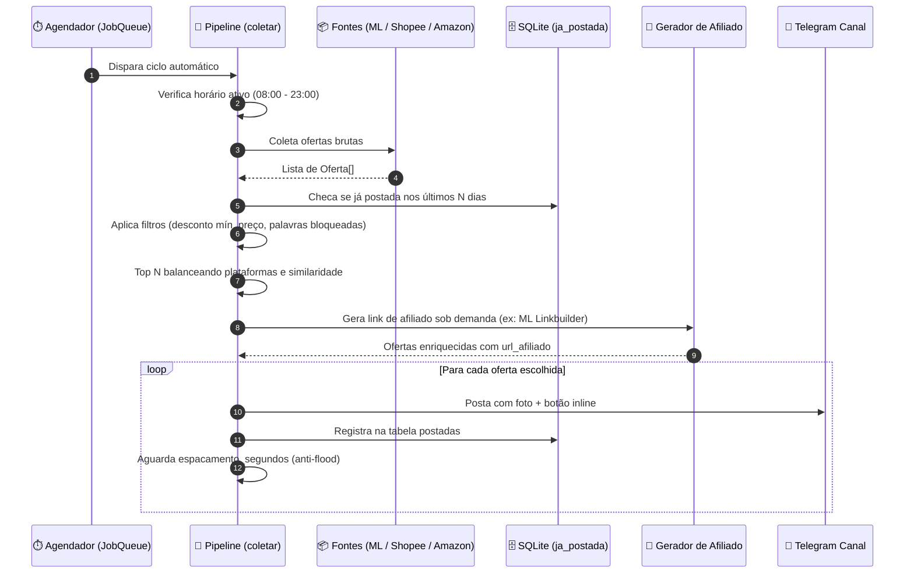

# 🏛️ Arquitetura do Sistema e Fluxo de Dados

O bot foi projetado para operar com **zero custo de infraestrutura**, rodando 100% de forma local no Windows ou servidor Linux/macOS via gerenciador de pacotes `uv`.

---

## 🔄 Fluxo de Execução do Pipeline (`pipeline.py`)

A esteira de processamento segue 5 estágios estritamente desacoplados:



---

## 🧩 Componentes Principais

### 1. Modelo Unificado de Dados (`models.py`)
Todas as fontes convertem respostas de APIs e scrapers no dataclass uniforme `Oferta`:

```python
@dataclass
class Oferta:
    plataforma: str            # "mercadolivre" | "shopee" | "amazon"
    id_produto: str
    titulo: str
    url_afiliado: str          # URL final com tag de comissão
    url_produto: str = ""
    preco: float | None = None
    preco_original: float | None = None
    desconto_pct: int | None = None
    imagem: str | None = None
    extra: str | None = None   # Avaliação ⭐, Frete Grátis, Cupom, etc.
```

- **`uid`:** Propriedade calculada única `{plataforma}:{id_produto}` para deduplicação no banco.
- **`desconto`:** Cálculo dinâmico caso a plataforma não envie a porcentagem explícita:
  $$\text{desconto} = \text{round}\left(100 \times \left(1 - \frac{\text{preco}}{\text{preco\_original}}\right)\right)$$

### 2. Algoritmo de Seleção e Balanceamento (`pipeline.escolher`)
Para evitar que o canal seja inundado por 10 produtos de uma mesma loja ou variações do mesmo item (ex: capas de celular de cores diferentes):
1. **Agrupamento por Plataforma:** Distribui ofertas em filas por loja.
2. **Rodízio Intercalado (*Round-Robin*):** Pega 1 produto de maior desconto de cada loja por rodada.
3. **Filtro de Similaridade Textual:** Compara as primeiras 5 palavras do título (`_chave_similar`) para impedir duplicatas visuais.

### 3. Concorrência Assíncrona Híbrida
- O bot utiliza `python-telegram-bot` em modo assíncrono (`async/await`).
- Operações pesadas de I/O bloqueante (scraping com `requests` e automação com `playwright`) são encapsuladas com `asyncio.to_thread(fn)` para **nunca congelar o bot do Telegram** nem o painel web.

---

## 🔗 Links Relacionados
- [[Configuracoes e Ambiente]] — Ajustes de intervalo, espaçamento e filtros.
- [[Banco de Dados e Deduplicacao]] — Como o SQLite evita repetições.
- [[Mercado Livre]], [[Amazon]], [[Shopee]] — Implementação específica de cada fonte.
- [[Bot Telegram e Postagens]] — Como o Telegram consome este pipeline.
