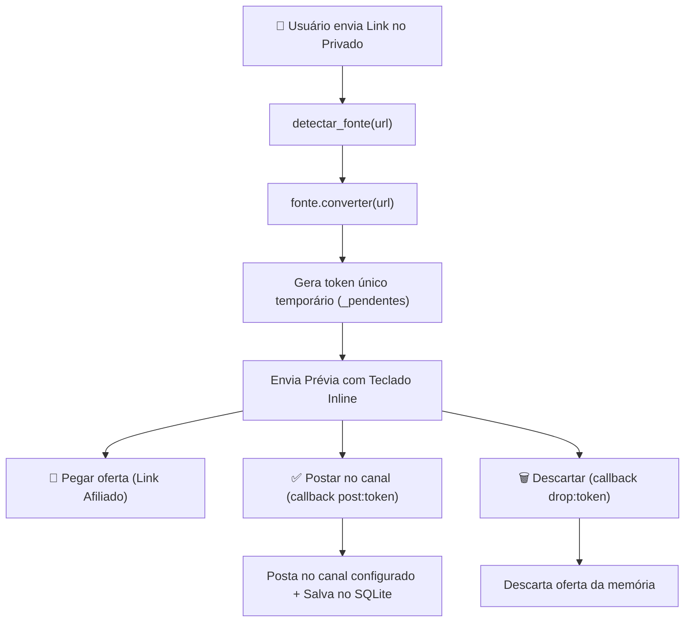

# 🤖 Bot Telegram, Comandos e Formatação de Mensagens

O bot opera simultaneamente em duas frentes:
1. **Publicador Automático de Canal:** Envia posts com foto, preço formatado e botão de compra.
2. **Assistente Privado do Administrador:** Converte links manuais, detecta IDs do chat e roda ciclos sob demanda.

---

## 💬 Comandos Interativos Disponíveis

| Comando | Escopo | Descrição |
| :--- | :--- | :--- |
| `/start` | Privado | Mensagem de boas-vindas com instruções e menu rápido |
| `/id` | Privado | Exibe o `User ID` atual e o `Chat ID` de mensagens encaminhadas |
| `/status` | Privado | Mostra total de ofertas postadas, fontes ativas e parâmetros atuais |
| `/ciclo` | Privado *(Apenas Dono)* | Dispara manualmente uma busca e postagem imediata |

> [!warning] Proteção de Acesso
> Comandos críticos e o conversor de links no privado verificam se `update.effective_user.id == config.owner_id`. Usuários não autorizados são ignorados silenciosamente para evitar abuso da sua cota de links.

---

## 🔄 Fluxo do Conversor Privado de Links

Ao enviar qualquer link do Mercado Livre, Shopee ou Amazon no privado do bot:



---

## 🎨 Anatomia do Post no Telegram (`formatter.py`)

As mensagens são enviadas preferencialmente via `bot.send_photo` com `parse_mode=ParseMode.HTML`. Caso a URL da imagem seja inválida ou recusada pelo Telegram, o bot faz *fallback* automático para `bot.send_message` em texto puro:

```html
🔥 <b>Samsung Galaxy S24 Ultra 512GB Titânio Cinza</b>

❌ De: <s>R$ 8.999,00</s>
✅ Por: <b>R$ 5.499,00</b>  🔻 <b>-39%</b>
⭐ 4.8 (1.250) · 🚚 Frete grátis · 💠 preço no Pix

💛 Mercado Livre
```

### Regras de Formatação Monetária (`formatter.preco_br`)
Converte números float para o padrão financeiro brasileiro:
$$\text{float}(5499.0) \implies \text{"R\$ 5.499,00"}$$

---

## 🔗 Links Relacionados
- [[Arquitetura do Sistema]] — Como o Telegram se integra ao pipeline principal.
- [[RFC-01 - Templates Customizaveis e Cupons]] — Proposta de melhoria para templates dinâmicos e cupons.
- [[RFC-02 - Multiplos Canais e Redes Sociais]] — Expansão para múltiplos canais e grupos.
