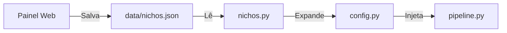

# ⚙️ Configurações, Ambiente e Variáveis de Controle

O sistema adota uma separação rigorosa de responsabilidades:
1. **`.env`** — Guarda exclusivamente dados sensíveis, credenciais e IDs privados (ignorado pelo Git).
2. **`config.yaml`** — Guarda parâmetros operacionais, intervalos, horários e filtros de negócio.
3. **`data/nichos.json`** — Guarda a seleção de nichos ativa definida pelo painel web.

---

## 🔒 Variáveis de Ambiente (`.env`)

| Variável | Descrição | Onde Obter | Obrigatório? |
| :--- | :--- | :--- | :--- |
| `TELEGRAM_BOT_TOKEN` | Token de autenticação da API do Telegram | [@BotFather](https://t.me/BotFather) | Sim |
| `TELEGRAM_CHAT_ID` | ID do Canal ou Grupo de destino (ex: `-100...`) | Encaminhar post para o bot / Painel | Sim |
| `TELEGRAM_OWNER_ID` | ID de usuário do dono do bot (segurança) | Comando `/id` no privado do bot | Sim |
| `ML_ETIQUETA` | Etiqueta de afiliado do Mercado Livre | Painel de Afiliados ML > Linkbuilder | Para ML |
| `AMAZON_TAG` | Tag de rastreamento do Amazon Associados | Amazon Associates Central | Para Amazon |
| `AMAZON_CREDENTIAL_ID` | Client ID da Creators API v1 | Associates Central > Creators API | Opcional |
| `AMAZON_CREDENTIAL_SECRET` | Secret da Creators API v1 | Associates Central > Creators API | Opcional |
| `SHOPEE_APP_ID` | App ID da Open API Shopee | Painel Shopee Afiliados > Abrir API | Para Shopee |
| `SHOPEE_APP_SECRET` | App Secret da Open API Shopee | Painel Shopee Afiliados > Abrir API | Para Shopee |

> [!important] Regra de Segurança do Painel Web
> O endpoint `/api/config` do [[Painel Web Local]] mascara automaticamente os campos marcados como `é_segredo: True` (como tokens e secrets), devolvendo apenas booleanos `chave__set: true` para nunca vazar senhas em tela.

---

## 📄 Arquivo de Negócio (`config.yaml`)

```yaml
geral:
  intervalo_minutos: 30        # Frequência de execução da busca automática
  max_posts_por_ciclo: 10      # Limite de ofertas enviadas por ciclo
  espacamento_segundos: 150    # Intervalo entre postagens no canal (anti-flood)
  nao_repetir_dias: 5          # Janela de deduplicação (SQLite)
  horario_ativo: "08:00-23:00" # Janela operacional permitida (vazio = 24h)

filtros:
  desconto_minimo: 25          # % mínimo de desconto aceito
  preco_minimo: 0              # 0 = sem piso
  preco_maximo: 0              # 0 = sem teto
  palavras_bloqueadas:         # Lista de termos a rejeitar no título
    - "capinha"
    - "película"

fontes:
  mercadolivre:
    ativa: true
    paginas: 1
    categorias: {}             # Vazio = todas. Preenchido = filtro por MLB
  amazon:
    ativa: true
    paginas: 1
    requisicoes_por_ciclo: 4   # Rodízio de requisições por ciclo (evita block)
    departamentos: {}
    buscas: []
  shopee:
    ativa: true
    limite: 40
    buscas: []
```

---

## 🎯 Sobrescrita Dinâmica por Nichos (`data/nichos.json`)

Quando o usuário seleciona nichos visuais no [[Painel Web Local]], o módulo `nichos.py` compila as seleções e **sobrescreve dinamicamente** as categorias do `config.yaml` em tempo de execução:



---

## 🔗 Links Relacionados
- [[Arquitetura do Sistema]] — Onde as variáveis de controle são consumidas.
- [[Painel Web Local]] — Interface para edição gráfica destas configurações.
- [[Guia de Manutencao e Debug]] — Como verificar inconsistências de configuração.
