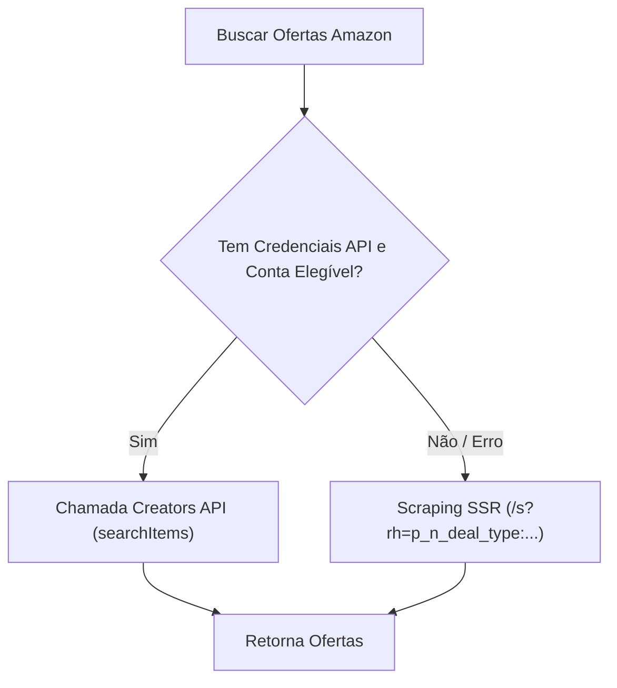

# 📦 Integração: Amazon (Creators API & Scraping Inteligente)

A integração com a Amazon possui arquitetura **Dual-Mode**, alternando com transparência entre a API oficial e um scraper inteligente com filtros de ofertas.

---

## 🚀 Modo 1: Creators API v1 (Oficial)

A **Creators API** substitui a antiga PA-API v5 para afiliados do programa Amazon Associates:

- **Autenticação OAuth2:** `POST https://api.amazon.com/auth/o2/token` com `client_credentials`.
- **Endpoint do Catálogo:** `POST https://creatorsapi.amazon/catalog/v1/searchItems` e `getItems`.
- **Marketplace:** `www.amazon.com.br`
- **Operação de Busca:**
  - `condition: "New"`
  - `minSavingPercent: X` (aplica o filtro de desconto direto no servidor da Amazon).

> [!note] Elegibilidade de API (`AssociateNotEligible`)
> A Amazon bloqueia a Creators API para contas novas sem histórico de vendas aprovadas nos últimos 90 dias. Se a API retornar `AssociateNotEligible`, o bot **ativa automaticamente o Modo 2 (Scraping)** e programa uma nova tentativa na API após 6 horas.

---

## 🕸️ Modo 2: Scraping de Listagens de Ofertas (`_buscar_por_scraping`)

Para garantir que a busca por scraping traga apenas promoções reais e não produtos com preço cheio, o scraper aplica os parâmetros de **Deal Types** da Amazon Brasil:

- **URL:** `https://www.amazon.com.br/s`
- **Parâmetros de Refinamento (`rh`):**
  - `p_n_deal_type:23565492011` (Ofertas do Dia)
  - `p_n_deal_type:23565493011` (Ofertas em Destaque)
  - `p_n_deal_type:210771957011` (Ofertas Relâmpago)

---

## 🛡️ Prevenção Anti-Bloqueio da Amazon
- **Sessão Persistente de Cookies:** Reutiliza a instância `requests.Session()` entre ciclos para não parecer uma nova conexão anônima a cada minuto.
- **Detecção de Bloqueio:** Analisa os primeiros 5.000 caracteres do HTML procurando termos como `robot check`, `captcha` ou títulos em branco.
- **Expansão de Links:** Converte links curtos `amzn.to` e `amzn.eu` para URLs canônicas antes de anexar a tag `?tag=SUA_TAG-20`.

---

## 🔗 Links Relacionados
- [[Arquitetura do Sistema]] — Ordem de execução das fontes.
- [[Configuracoes e Ambiente]] — Variáveis `AMAZON_TAG` e credenciais.
- [[Guia de Manutencao e Debug]] — Como lidar com CAPTCHAs na Amazon.
