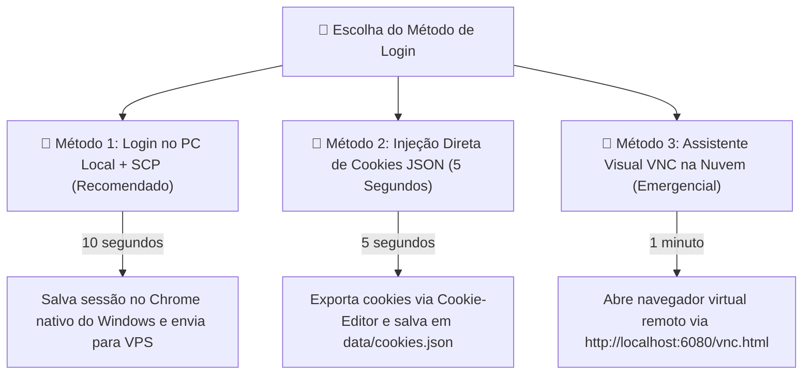

# 💛 Integração: Mercado Livre (Scraping, Linkbuilder & Métodos de Login Rápido)

O Mercado Livre não oferece uma API REST pública e aberta para afiliados. Por esse motivo, a integração utiliza uma abordagem híbrida de alta performance:
1. **Busca de Ofertas:** Scraping HTTP rápido via `BeautifulSoup` (sem navegador).
2. **Geração de Links de Afiliado:** Automação com **Playwright** conectado ao perfil real do Chrome (`data/ml_profile`) ou injeção de cookies para chamar a API interna do Linkbuilder.

---

## 🔍 1. Coleta de Ofertas (`mercadolivre.buscar_ofertas`)

- **URL Base:** `https://www.mercadolivre.com.br/ofertas`
- **Filtro de Categoria:** Parâmetro `category=MLB...` (ex: `MLB1648` para Informática).
- **Seletores CSS Atuais:**
  - Card: `div.poly-card`
  - Título e Link: `a.poly-component__title`
  - Preço Atual: `.poly-price__current .andes-money-amount__fraction`
  - Preço Anterior: `s.andes-money-amount--previous .andes-money-amount__fraction`
  - Selo de Desconto: `.poly-price__discount-polylabel, .andes-money-amount__discount`
  - Imagem: `img.poly-component__picture` (com fallback de `data-src`)

> [!warning] Alerta de Mudança de Layout
> O Mercado Livre troca o prefixo de classes de seus componentes frontend periodicamente (`ui-search-`, `poly-`, `andes-`). Caso a coleta retorne 0 ofertas, verifique a [[RFC-04 - Resiliencia e Fallback JSON-LD]] para a implementação de fallback em dados estruturados.

---

## ⚡ 2. Métodos de Autenticação e Login Rápido (Sem Lentidão de VNC)

Para gerar os links de comissão `meli.la/...`, o bot precisa estar autenticado na sua conta de afiliado. Existem **3 métodos de autenticação**, dos mais rápidos aos alternativos:



### 🥇 Método 1: Login no PC Local e Envio para a VPS (Mais Fluido e Seguro)
1. No seu computador Windows (com o Chrome nativo ultra rápido), abra o terminal e execute:
   ```powershell
   uv run python -m ofertas ml-login
   ```
2. O Google Chrome do Windows abrirá instantaneamente. Faça login com seu e-mail, senha e 2FA.
3. Confira se o painel do Linkbuilder abriu logado e feche o navegador.
4. Envie a sessão para a VPS com 1 único comando no PowerShell:
   ```powershell
   scp -i "C:\Users\henri\Downloads\minha-chave.pem" -r "C:\Users\henri\Downloads\bot-ofertas-telegram\data\ml_profile" ubuntu@15.229.68.67:/home/ubuntu/bot-ofertas-telegram/data/
   ```

---

### 🥈 Método 2: Injeção de Cookies JSON (`data/cookies.json` em 5 Segundos)
Se você já usa o Mercado Livre no seu navegador habitual:
1. Instale a extensão segura **[Cookie-Editor](https://cookie-editor.com/)** (ou *Get cookies.txt*).
2. Acesse o [Mercado Livre Brasil](https://www.mercadolivre.com.br) já logado na sua conta.
3. Clique no ícone do Cookie-Editor e selecione **"Export" $\to$ "Export as JSON"**.
4. Crie/cole o conteúdo em um arquivo `cookies.json` dentro da pasta `data/`:
   ```json
   [
     {"name": "ssid", "value": "...", "domain": ".mercadolivre.com.br", ...},
     {"name": "_d2id", "value": "...", "domain": ".mercadolivre.com.br", ...}
   ]
   ```
5. O bot carrega esses cookies diretamente, chamando a API do Linkbuilder via HTTP leve em **0,05 segundos**.

---

### 🥉 Método 3: Assistente Visual VNC Remoto (`ml_login_web.sh`)
Útil quando você está fora de casa e só tem acesso SSH à VPS:
1. Conecte na VPS com túnel de porta:
   ```powershell
   ssh -i "C:\Users\henri\Downloads\minha-chave.pem" -L 6080:localhost:6080 ubuntu@15.229.68.67
   ```
2. Na VPS, execute: `./bot-ofertas-telegram/ml_login_web.sh`
3. Abra no navegador: `http://localhost:6080/vnc.html` e clique em **Connect**.
4. Faça o login e aperte `Ctrl+C` no terminal para encerrar.

---

## 🔗 3. Geração de Links de Afiliado (`Linkbuilder API`)

O painel de afiliados do Mercado Livre possui uma API interna autenticada pelos cookies da sessão:

- **Endpoint:** `POST https://www.mercadolivre.com.br/affiliate-program/api/v2/affiliates/createLink`
- **Payload:**
  ```json
  {
    "urls": ["https://produto.mercadolivre.com.br/MLB-123456..."],
    "tag": "SUA_ETIQUETA_ML"
  }
  ```
- **Resposta:**
  ```json
  {
    "status": 200,
    "urls": [
      {
        "id": "12345",
        "short_url": "https://meli.la/1abcXYZ"
      }
    ]
  }
  ```

---

## 🔄 4. Conversor de Links (`mercadolivre.converter`)

Quando o usuário cola um link do ML no privado:
1. Se for link encurtado (`meli.la/...`), expande o redirecionamento via `requests.head/get`.
2. Extrai o ID `MLB...` por Regex.
3. Faz scraping dos dados da página (`h1.ui-pdp-title`, `meta[itemprop="price"]`, etc.).
4. Gera o link com a tag via Linkbuilder.

---

## 🔗 Links Relacionados
- [[Index]] — Central de navegação do Cérebro.
- [[Arquitetura do Sistema]] — Onde os links são gerados no pipeline.
- [[Guia de Manutencao e Debug]] — Como renovar a sessão do Mercado Livre.
- [[Guia de Deploy em VPS Linux]] — Deploy na nuvem AWS.
- [[Guia de Servidor Caseiro 24-7 (Raspberry Pi e Mini PC)]] — Deploy em hardware local.
- [[RFC-04 - Resiliencia e Fallback JSON-LD]] — Proteção contra quebra de seletores.
