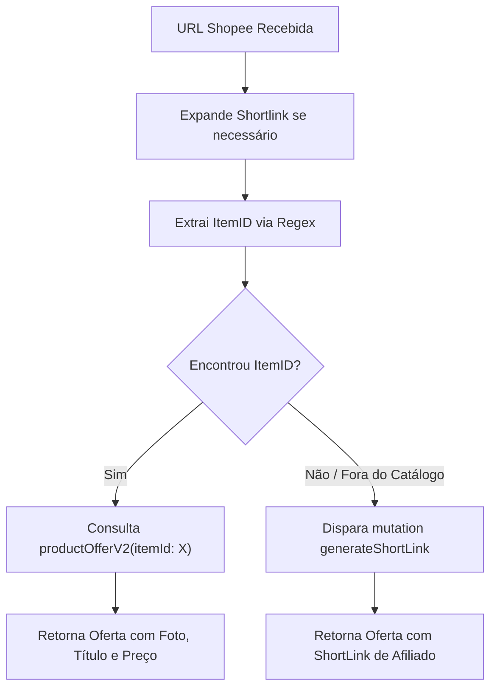

# 🧡 Integração: Shopee (GraphQL Open API Oficial)

A integração com a Shopee é **100% via API oficial (GraphQL)**, eliminando riscos de quebra por alteração de layout HTML.

---

## 🔐 1. Autenticação Criptográfica (HMAC-SHA256)

A Shopee exige uma assinatura criptográfica customizada calculada no momento exato do envio da requisição:

- **Endpoint:** `POST https://open-api.affiliate.shopee.com.br/graphql`
- **Algoritmo da Assinatura:**
  $$\text{fator} = \text{AppId} + \text{Timestamp} + \text{PayloadJSON} + \text{AppSecret}$$
  $$\text{Signature} = \text{SHA256}(\text{fator})$$
- **Header `Authorization`:**
  ```http
  Authorization: SHA256 Credential={SHOPEE_APP_ID}, Timestamp={ts}, Signature={assinatura}
  ```

---

## 📡 2. Consultas GraphQL (`productOfferV2`)

A busca utiliza a query `productOfferV2` com ordenação por **Mais Vendidos** (`sortType: 2`):

```graphql
query {
  productOfferV2(
    keyword: "fone bluetooth",
    sortType: 2,
    page: 1,
    limit: 20
  ) {
    nodes {
      itemId
      productName
      priceMin
      priceMax
      priceDiscountRate
      imageUrl
      offerLink         # Já devolve o link final com sua comissão
      productLink
      sales
      ratingStar
      shopName
    }
  }
}
```

> [!tip] Link Pronto com Comissão
> O campo `offerLink` retornado pelo GraphQL já contém a comissão do seu AppId embutida, sem necessidade de encurtadores intermediários adicionais.

---

## 🔄 3. Conversor de Links (`shopee.converter`)

Quando o usuário envia um link de produto ou shortlink da Shopee (`shp.ee/...` ou `s.shopee.com.br/...`):



---

## 🔗 Links Relacionados
- [[Arquitetura do Sistema]] — Fluxo de dados e fontes.
- [[Configuracoes e Ambiente]] — Configuração de `SHOPEE_APP_ID` e `SHOPEE_APP_SECRET`.
- [[Guia de Manutencao e Debug]] — Diagnóstico de erros na API da Shopee.
