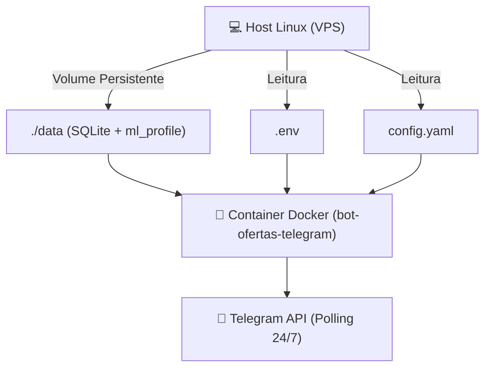

# 🌐 Guia de Deploy em VPS Linux (24/7 na Nuvem)

Este guia documenta o processo de colocar o bot para rodar 24/7 em uma **VPS Linux** (Ubuntu 22.04 / 24.04 ou Debian 12), usando **Docker Compose** ou **Systemd**.

---

## 🏗️ Arquitetura do Container Linux (`Dockerfile`)

O container foi construído sob uma imagem base leve `python:3.12-slim` contendo:
1. Pacotes de renderização gráfica e áudio do X11/Mesa/NSS exigidos pelo Chromium do Playwright em modo headless.
2. Binário nativo do `uv` (`ghcr.io/astral-sh/uv`) para sincronização congelada de dependências (`uv.lock`).
3. Fuso horário configurado para `America/Sao_Paulo` (para sincronizar o `horario_ativo`).



---

## 🚀 Métodos de Execução

### Opção A: Docker Compose (Recomendado)
```bash
# Sobe o container em segundo plano com auto-restart
docker compose up -d --build

# Visualização de logs contínuos
docker compose logs -f
```

### Opção B: Serviço Nativo do Sistema (`systemd`)
Usando o script `setup_linux.sh` e o template `bot-ofertas.service`:

```bash
# 1. Instalação automatizada
chmod +x setup_linux.sh && ./setup_linux.sh

# 2. Ativação no Systemd
sudo cp bot-ofertas.service /etc/systemd/system/
sudo systemctl daemon-reload
sudo systemctl enable --now bot-ofertas
```

---

## 🔑 Migração de Sessão do Mercado Livre

Como o login do Mercado Livre exige autenticação 2FA em navegador gráfico:
1. Execute o login localmente no seu computador via `uv run python -m ofertas ml-login`.
2. Envie o perfil persistente para a VPS via SCP:
   ```bash
   scp -r data/ml_profile root@IP_DA_VPS:/caminho/do/bot/data/
   ```
3. O Playwright na VPS reutiliza a sessão salva sem necessidade de interface gráfica (`headless=True`).

---

## 🔗 Links Relacionados
- [[Index]] — Central de navegação do Cérebro.
- [[Arquitetura do Sistema]] — Visão geral da esteira assíncrona.
- [[Mercado Livre]] — Detalhes da sessão do Linkbuilder.
- [[Guia de Manutencao e Debug]] — Comandos úteis de diagnóstico.
