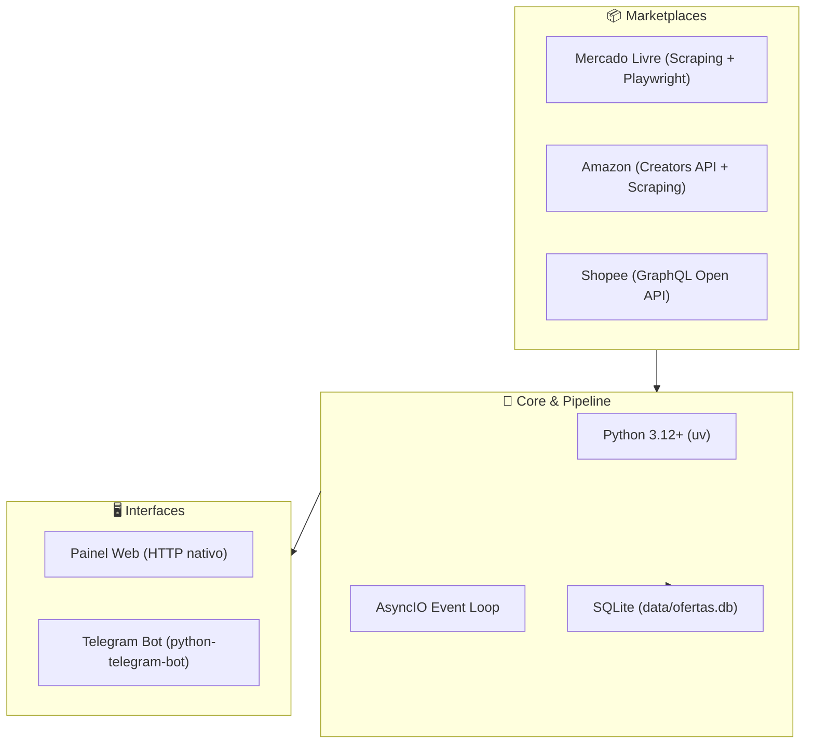

# 🧠 Cérebro do Projeto: Bot de Ofertas Telegram

Bem-vindo ao **Knowledge Vault** (Cérebro) do **Bot de Ofertas para Telegram**. Esta base de conhecimento centraliza toda a arquitetura, regras de negócio, integrações com marketplaces e planos de evolução contínua do projeto.

> [!tip] Como usar este Cérebro no Obsidian
> Todas as notas estão interligadas por **Wikilinks (`[[Nome da Nota]]`)**. Você pode navegar clicando nos links, abrir a visualização em grafo (**Graph View**) para ver a teia de dependências ou usar o atalho `Ctrl+O` para buscar qualquer tópico rapidamente.

---

## 🗺️ Mapa de Conteúdo (MOC)

### 🏛️ Fundamentos & Arquitetura
- [[Arquitetura do Sistema]] — Visão geral da esteira de dados: Coleta, Filtragem, Balanceamento, Encurtamento de Afiliados e Postagem.
- [[Configuracoes e Ambiente]] — Variáveis do `.env`, parâmetros do `config.yaml`, proteção de credenciais e horários ativos.
- [[Banco de Dados e Deduplicacao]] — Modelo relacional SQLite (`data/ofertas.db`), retenção temporal e prevenção de spam.

### 🤖 Interfaces & Controle
- [[Bot Telegram e Postagens]] — Comandos interativos (`/start`, `/id`, `/status`, `/ciclo`), conversor privado com aprovação e anatomia das mensagens.
- [[Painel Web Local]] — Interface gráfica embutida (`127.0.0.1:8481`), endpoints JSON nativos e painel de diagnóstico.

### 📦 Marketplace Scrapers & APIs
- [[Mercado Livre]] — Coleta da página de ofertas, automação com Playwright no perfil persistente e API interna do Linkbuilder.
- [[Amazon]] — Creators API v1 oficial com fallback para busca SSR refinada por *Deal Types* e enriquecimento de produtos.
- [[Shopee]] — Integração com GraphQL Open API oficial, autenticação com assinatura HMAC-SHA256 e conversão de shortlinks.

### 🛠️ Operação, Suporte & Manutenção
- [[Guia de Deploy em VPS Linux]] — Como subir o bot 24/7 em servidores Linux na nuvem (AWS, Docker Compose e Systemd).
- [[Guia de Servidor Caseiro 24-7 (Raspberry Pi e Mini PC)]] — Como transformar um PC antigo, TV Box ou Raspberry Pi em servidor 24/7 de baixíssimo consumo com IP residencial.
- [[Guia de Manutencao e Debug]] — Checklist de erros comuns (bloqueios anti-bot, expiração de cookies, Smart App Control no Windows) e rotinas de teste.
- [[Roadmap e Evolucao]] — Visão estratégica de versões futuras, novas features e melhorias de performance.

---

## 💡 RFCs & Especificações Técnicas para Futuras Atualizações

Use estas RFCs para guiar o desenvolvimento das próximas versões sem comprometer o código existente:

| RFC | Título | Status | Prioridade |
| :--- | :--- | :--- | :--- |
| [[RFC-01 - Templates Customizaveis e Cupons\|RFC-01]] | Templates Customizáveis e Destaque de Cupons | 🟡 Proposto | Alta |
| [[RFC-02 - Multiplos Canais e Redes Sociais\|RFC-02]] | Múltiplos Canais Telegram, Grupos e Webhooks | 🟡 Proposto | Média |
| [[RFC-03 - Novas Plataformas (Magalu e AliExpress)\|RFC-03]] | Integração Magalu e AliExpress | 🟡 Proposto | Alta |
| [[RFC-04 - Resiliencia e Fallback JSON-LD\|RFC-04]] | Resiliência dos Scrapers e Fallback JSON-LD | 🟡 Proposto | Alta |

---

## 📊 Visão Geral da Stack Tecnológica

---

## 🏷️ Tags Principais
#arquitetura #afiliados #telegram #scrapers #python #seguranca #roadmap
