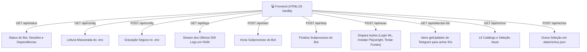

# 🖥️ Painel Web Local e Servidor Embutido

O **Painel de Controle** (`painel.py` e `painel_html.py`) foi desenvolvido com **Python puro e zero frameworks pesados** (sem Flask/FastAPI/Node), utilizando as bibliotecas padrão `http.server.ThreadingHTTPServer` e `http.server.BaseHTTPRequestHandler`.

---

## 🌐 Endereço & Conectividade
- **Host & Porta:** `127.0.0.1:8481` (Porta dedicada para evitar conflitos locais).
- **Abertura Automática:** O script invoca `webbrowser.open("http://127.0.0.1:8481/")` ao iniciar.
- **Segurança de Rede:** Vinculado estritamente à interface de *loopback* (`127.0.0.1`), impedindo acessos externos não autorizados via rede local.

---

## 📡 Endpoints da API Interna

---

## ⚙️ Gestão de Processos em Segundo Plano (`painel.Processo`)

O painel controla duas instâncias de subprocesso:
1. `bot`: Processo persistente que executa `python -m ofertas run`.
2. `acao`: Processo temporário para tarefas assíncronas de manutenção (como instalação de navegador ou testes de scraping).

### Captura de Logs
Os logs de `stdout` e `stderr` dos subprocessos são lidos via `threading.Thread` daemon e acumulados em uma estrutura `collections.deque(maxlen=500)`, garantindo uso previsível e fixo de memória.

---

## 🔗 Links Relacionados
- [[Configuracoes e Ambiente]] — Como o painel manipula o `.env` e `nichos.json`.
- [[Mercado Livre]] — Acionamento da rotina `ml-login` pelo painel.
- [[Guia de Manutencao e Debug]] — Testes de fontes e diagnóstico via painel.
