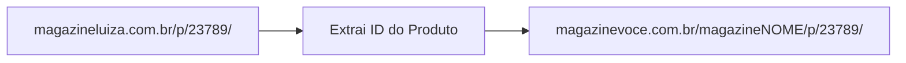

# 💡 RFC-03: Novas Plataformas de Afiliados (Magalu e AliExpress)

## 📋 Resumo
Esta RFC especifica o design da arquitetura para a inclusão de dois novos gigantes do e-commerce brasileiro: **Magazine Luiza (Magazine Você)** e **AliExpress (Portals Open API)**.

---

## 🛍️ 1. Magazine Luiza (`sources/magalu.py`)

### Estratégia de Afiliado
- O Magazine Você (Magalu) gera links de loja no formato: `https://www.magazinevoce.com.br/magazineSEUNOME/p/ID_PRODUTO/...`
- **Coleta:** Scraping da vitrine da sua loja ou busca nas ofertas do dia (`magazineluiza.com.br/selecao/ofertasdodia/`).
- **Conversão de URL:** Reescrita do domínio original para o subdomínio do seu `magazinevoce`.



---

## 🌐 2. AliExpress (`sources/aliexpress.py`)

### Estratégia de Afiliado
- Utiliza a API oficial **AliExpress Portals Open API** (`aliexpress.affiliate.product.query` e `aliexpress.affiliate.link.generate`).
- **Comissões:** Pagamento em USD/BRL via programa global de afiliados.
- **Autenticação:** Assinatura com `AppKey` e `AppSecret`.

---

## 🧩 Interface de Módulo Padronizada
Para adicionar qualquer nova plataforma ao bot, o arquivo em `sources/` deve implementar o seguinte contrato padronizado:

```python
# Contrato obrigatório de uma fonte:
def e_link(url: str) -> bool: ...
def buscar_ofertas() -> list[Oferta]: ...
def converter(url: str) -> Oferta: ...
```

---

## 🔗 Links Relacionados
- [[Mercado Livre]], [[Amazon]], [[Shopee]] — Padrões seguidos pelas fontes atuais.
- [[Arquitetura do Sistema]] — Como novas fontes se plugam no pipeline.
- [[Roadmap e Evolucao]] — Cronograma para novas fontes.
