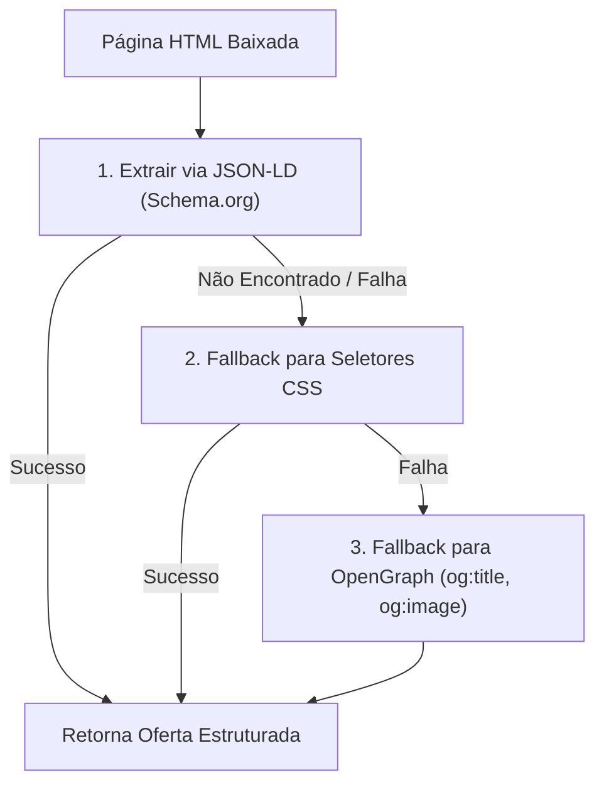

# 💡 RFC-04: Resiliência de Scrapers e Fallback JSON-LD

## 📋 Resumo
Atualmente, a extração de dados no Mercado Livre e Amazon apoia-se em seletores CSS (`.poly-card`, `.andes-money-amount`). Como os e-commerces alteram classes HTML com frequência para otimização de bundle e anti-scraping, esta RFC propõe um extrator baseado em **Dados Estruturados Schema.org / JSON-LD** como camada primária ou de fallback.

---

## 🎯 Por que JSON-LD?
Quase todas as grandes plataformas de e-commerce inserem tags `<script type="application/ld+json">` para permitir que o Google indexe preços, avaliações e imagens de produtos:

```html
<script type="application/ld+json">
{
  "@context": "https://schema.org",
  "@type": "Product",
  "name": "Smartphone Galaxy S24",
  "image": "https://http2.mlstatic.com/...",
  "offers": {
    "@type": "Offer",
    "price": "5499.00",
    "priceCurrency": "BRL",
    "availability": "https://schema.org/InStock"
  }
}
</script>
```

> [!tip] Vantagem do JSON-LD
> O formato Schema.org é um padrão mundial estrito da W3C. Mesmo que o Mercado Livre altere todo o CSS de `andes-*` para `poly-*`, o bloco JSON-LD permanece inalterado para não prejudicar o SEO no Google.

---

## 📐 Estratégia de Implementação (`utils.py`)

Criar um parser universal de metadados de produto:

```python
import json
from bs4 import BeautifulSoup

def extrair_produto_jsonld(html: str) -> dict | None:
    soup = BeautifulSoup(html, "lxml")
    for script in soup.find_all("script", type="application/ld+json"):
        try:
            dados = json.loads(script.string or "")
            if isinstance(dados, list):
                dados = dados[0]
            if dados.get("@type") == "Product":
                return {
                    "titulo": dados.get("name"),
                    "imagem": dados.get("image"),
                    "preco": float((dados.get("offers") or {}).get("price", 0)) or None,
                }
        except (json.JSONDecodeError, TypeError, ValueError):
            continue
    return None
```

---

## 🔄 Fluxo de Resiliência nos Conversores



---

## 🔗 Links Relacionados
- [[Mercado Livre]] — Scraper atual do ML.
- [[Amazon]] — Scraper atual da Amazon.
- [[Guia de Manutencao e Debug]] — Diagnóstico de páginas bloqueadas.
