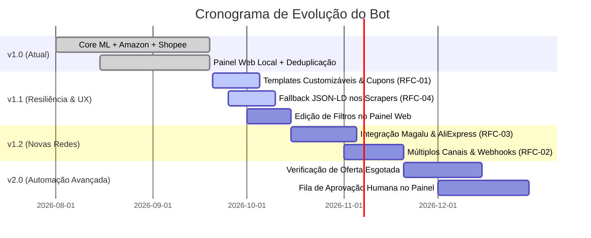

# 🚀 Roadmap Estratégico e Evolução do Projeto

Este documento detalha o planejamento de versões e prioridades de engenharia para as futuras atualizações do bot de ofertas.

---

## 🎯 Visão Geral de Versões

---

## 📌 Detalhamento das Frentes de Trabalho

### Fase 1: Resiliência e Conversão Imediata (v1.1)
- [ ] **Templates e Cupons ([[RFC-01 - Templates Customizaveis e Cupons]]):**
  - Permitir templates editáveis no `config.yaml` com placeholders `{titulo}`, `{preco}`, `{cupom}`, `{link}`.
  - Destaque monoespaçado de cupons `<code>CUPOM10</code>` para cópia facilitada no Telegram.
- [ ] **Resiliência contra Mudanças de Layout ([[RFC-04 - Resiliencia e Fallback JSON-LD]]):**
  - Adicionar parser de metadados estruturados Schema.org / JSON-LD no scraper do Mercado Livre e Amazon.
- [ ] **Filtros Editáveis no Painel Web:**
  - Adicionar sliders e inputs para `desconto_minimo`, `intervalo_minutos` e `horario_ativo` na interface gráfica.

### Fase 2: Expansão de Marketplaces e Destinos (v1.2)
- [ ] **Novas Lojas Parceiras ([[RFC-03 - Novas Plataformas (Magalu e AliExpress)]]):**
  - Inclusão do **Magazine Luiza** (Magazine Você) e **AliExpress** (Open API de Afiliados).
- [ ] **Distribuição Multi-Canal ([[RFC-02 - Multiplos Canais e Redes Sociais]]):**
  - Postagem simultânea em canais segmentados (ex: Canal VIP de Informática e Canal Geral).
  - Envio opcional para Discord via Webhooks.

### Fase 3: Recursos Avançados de Comunidade (v2.0)
- [ ] **Alerta de Super Desconto / Possível Bug:**
  - Identificação de promoções com $>65\%$ de desconto e formatação com sirenes 🚨.
- [ ] **Monitoramento de Estoque & Oferta Esgotada:**
  - Re-checagem periódica dos últimos 10 posts para editar a mensagem no canal com selo `[PROMOÇÃO ENCERRADA]`.

---

## 🔗 Links Relacionados
- [[Index]] — Central de navegação do Cérebro.
- [[RFC-01 - Templates Customizaveis e Cupons]]
- [[RFC-02 - Multiplos Canais e Redes Sociais]]
- [[RFC-03 - Novas Plataformas (Magalu e AliExpress)]]
- [[RFC-04 - Resiliencia e Fallback JSON-LD]]
